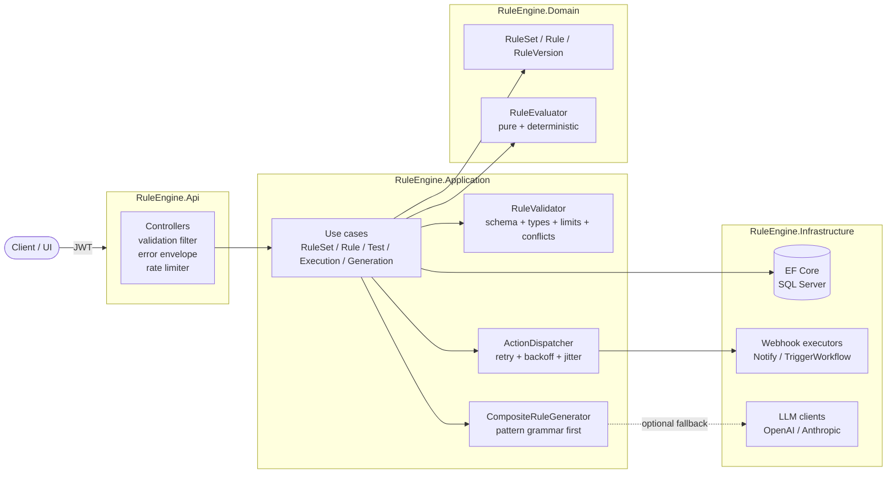
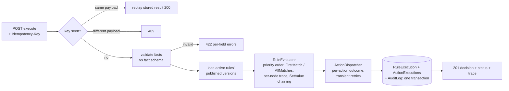
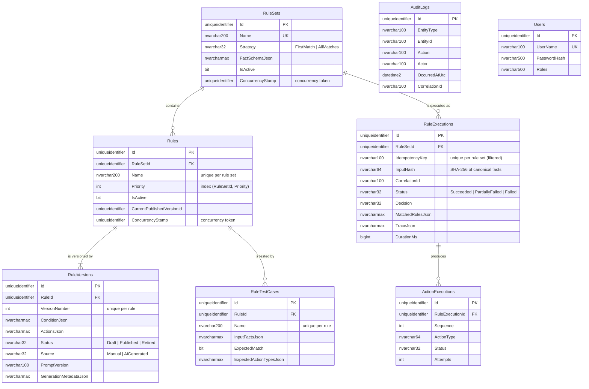
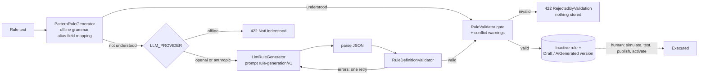

# AI Rule Engine

Versioned, explainable business rules for document workflows: a deterministic JSON rule evaluator with simulation,
rule tests, idempotent execution and audit, plus AI-assisted rule authoring that only ever produces reviewable drafts.

[](https://github.com/unmeshpawar7-cpu/ai-rule-engine/actions/workflows/ci.yml)
[](LICENSE)


## Problem

Approval policies ("orders above 10 units need a manager", "reject critical-risk suppliers") usually live in
application code or in spreadsheets that developers translate into code. Changing a threshold needs a release,
nobody can say which version of a policy approved a given document, and testing a change against real cases is
manual. Letting an LLM write the rules makes authoring easier but adds a new risk: confidently wrong rules.

## Solution

* Rules are **data**: a typed JSON condition tree and a list of typed actions, validated against a per-rule-set
  **fact schema** before they are stored.
* Every change creates an **immutable rule version** (Draft -> Published -> Retired). Executions record which
  versions matched, with a per-node trace of expected vs actual values.
* A pure, deterministic **evaluator** powers execution, side-effect-free **simulation** (including drafts) and
  per-rule **test cases**; publishing can require all tests to pass.
* **Execution** validates facts, evaluates, executes actions with retry/backoff, and stores the execution, the
  per-action outcomes and an audit record in one transaction. `Idempotency-Key` makes client retries safe.
* **AI-assisted authoring** turns a sentence into a proposal. A deterministic offline grammar runs first; an LLM
  (OpenAI or Anthropic) is an optional fallback. Every proposal passes the same validation gate as manual rules and
  is saved only as an inactive **Draft**. Nothing generated is ever published or executed automatically.

## Architecture



Clean Architecture: `Api -> Infrastructure -> Application -> Domain`; the Domain project has no package references.
Execution pipeline:



More detail, including sequence diagrams: [docs/architecture.md](docs/architecture.md).

## Key Features

* **Typed rule DSL**: `all` / `any` / `not` + 15 operators (`Equals` ... `Between`, `In`, `Contains`, `Matches` with
  regex timeout, `IsNull` ...) with typed semantics for String, Number (decimal), Boolean, Date and StringList.
  Depth, node, action and regex-length limits. See [docs/rule-dsl.md](docs/rule-dsl.md).
* **Fact schema per rule set** with aliases; execution input is validated against it (422 with JSON paths).
* **Immutable versions**: Draft / Published / Retired, at most one published, `Manual` or `AiGenerated` source,
  prompt version stored for AI drafts, optimistic concurrency (`ConcurrencyStamp`).
* **Evaluation strategies** `FirstMatch` and `AllMatches`, priority ordering (lower first, deterministic
  tie-break), `SetValue` actions visible to later rules.
* **Explainability**: trace per rule and per node with expected vs actual values and notes (missing fact,
  uncoercible value, regex timeout).
* **Actions**: `SetValue`, `RequireApproval`, `AddTag`, `Reject`, `Notify` and `TriggerWorkflow` (webhooks), one
  `IActionExecutor` per type, transient failures retried with exponential backoff + jitter, overall status
  `Succeeded` / `PartiallyFailed` / `Failed` and a business decision (`NoMatch`, `Accepted`, `ApprovalRequired`, `Rejected`).
* **Idempotent execution** (`Idempotency-Key`, canonical input hash, unique index as the race guard).
* **Simulation** of drafts and inactive rules with no side effects.
* **Rule test cases** with a runner and an optional publish gate.
* **Conflict detection**: warns when a rule overlaps an active rule at the same priority with contradictory actions.
* **AI-assisted authoring** with deterministic-first generation, validation gate and Draft-only persistence.
* **Audit log** written in the same transaction as each change and execution; queryable by auditors.
* JWT auth with four roles, per-user rate limit on generation, envelope + pagination on every endpoint, Swagger
  with XML docs, Serilog with correlation ids, health checks, Docker and CI.

## Technology Stack

| Area | Choice |
|---|---|
| Runtime | .NET 8, ASP.NET Core Web API (controllers), C# 12 |
| Persistence | EF Core 8 + SQL Server (hand-authored `InitialCreate` migration); SQLite for integration tests; EF in-memory for unit tests |
| Validation | FluentValidation 11 (requests), custom `RuleDefinitionValidator` (rules) |
| Auth | JWT bearer (HS256), `PasswordHasher<User>` from `Microsoft.Extensions.Identity.Core` |
| Observability | Serilog (compact JSON console), correlation ids, health checks |
| API docs | Swashbuckle 6 with XML comments |
| AI | Offline pattern grammar; optional OpenAI Chat Completions / Anthropic Messages over typed `HttpClient`s (no SDKs) |
| Tests | xUnit, FluentAssertions, NSubstitute, `WebApplicationFactory` |
| Delivery | Multi-stage Docker image (non-root), docker-compose with SQL Server 2022, GitHub Actions |

## Project Structure

```
ai-rule-engine/
├── src/
│   ├── RuleEngine.Domain/          aggregates, condition DSL, operators, RuleEvaluator, fact schema
│   ├── RuleEngine.Application/     use cases, RuleValidator + ConflictDetector, ActionDispatcher,
│   │                               PatternRuleGenerator, RuleTestRunner, audit, auth, DI
│   ├── RuleEngine.Infrastructure/  EF Core DbContext, configurations, Migrations/, webhook executors,
│   │                               Ai/ (OpenAI + Anthropic clients, LlmRuleGenerator, Prompts/rule-generation-v1.md)
│   └── RuleEngine.Api/             controllers, Program.cs, JWT, error envelope, correlation id middleware
├── tests/
│   ├── RuleEngine.UnitTests/       domain, application and infrastructure tests
│   └── RuleEngine.IntegrationTests/ API tests over SQLite with real JWTs
├── samples/purchase-approval/      rule set, rules, test cases, facts, natural-language prompts
├── docs/                           architecture, rule DSL, AI generation, API examples, ADRs
├── docker/Dockerfile
├── docker-compose.yml
└── .github/workflows/ci.yml
```

## API Endpoints

All routes require a bearer token except `POST /api/auth/token` and the health checks.

| Method | Route | Roles | Description |
|---|---|---|---|
| POST | `/api/auth/token` | anonymous | Exchange user name + password for a JWT |
| GET | `/api/rulesets` | any | List rule sets (paged, `search`, `isActive`) |
| GET | `/api/rulesets/{id}` | any | Get a rule set with its fact schema |
| POST | `/api/rulesets` | RuleAdmin, RuleAuthor | Create a rule set (201) |
| PUT | `/api/rulesets/{id}` | RuleAdmin, RuleAuthor | Update description / strategy |
| PUT | `/api/rulesets/{id}/fact-schema` | RuleAdmin, RuleAuthor | Replace the fact schema (fields in use cannot be removed) |
| POST | `/api/rulesets/{id}/activate` / `deactivate` | RuleAdmin | Toggle execution of the rule set |
| DELETE | `/api/rulesets/{id}` | RuleAdmin | Delete an empty rule set (409 otherwise) |
| GET | `/api/rules` | any | List rules (paged; `ruleSetId`, `isActive`, `hasDraft`, `source`, `search`) |
| GET | `/api/rules/{id}` | any | Rule with all versions |
| POST | `/api/rulesets/{id}/rules` | RuleAdmin, RuleAuthor | Create a rule with a Draft version (201 + conflict warnings) |
| POST | `/api/rulesets/{id}/rules/generate` | RuleAdmin, RuleAuthor | Natural language -> validated Draft (rate limited) |
| POST | `/api/rules/{id}/versions` | RuleAdmin, RuleAuthor | Add a Draft version |
| POST | `/api/rules/{id}/publish` | RuleAdmin | Publish a draft (tests must pass when configured) |
| POST | `/api/rules/{id}/activate` / `deactivate` | RuleAdmin | Toggle the rule |
| DELETE | `/api/rules/{id}/versions/{n}` | RuleAdmin, RuleAuthor | Delete a draft version |
| GET/POST | `/api/rules/{id}/tests` | any / RuleAdmin, RuleAuthor | List / create test cases |
| GET/PUT/DELETE | `/api/rules/{id}/tests/{testId}` | any / RuleAdmin, RuleAuthor | Read / replace / delete a test case |
| POST | `/api/rules/{id}/tests/run?versionNumber=` | RuleAdmin, RuleAuthor | Run all test cases against a version |
| POST | `/api/rulesets/{id}/execute` | RuleAdmin, Executor | Execute (201; `Idempotency-Key` replay 200; 409 on payload change) |
| POST | `/api/rulesets/{id}/simulate` | RuleAdmin, RuleAuthor, Executor | Dry run incl. drafts, no side effects |
| GET | `/api/executions` | RuleAdmin, Executor, Auditor | List executions (paged, filters) |
| GET | `/api/executions/{id}` | RuleAdmin, Executor, Auditor | Execution with action outcomes and trace |
| GET | `/api/audit-logs` | RuleAdmin, Auditor | Audit records (paged, filters) |
| GET | `/health/live`, `/health/ready` | anonymous | Liveness / database readiness |

Errors always use `{ "success": false, "message", "errors": [{ "field", "message", "code" }], "traceId" }`;
lists return `{ items, page, pageSize, totalCount, totalPages }` with `pageSize` capped at 100.

## Database Design



Enums are stored as strings and JSON documents as `nvarchar(max)` (portable to SQLite and readable in SQL).
The migration `src/RuleEngine.Infrastructure/Persistence/Migrations/20261008000000_InitialCreate.cs` and its model
snapshot were **hand-authored to match the EF Core model** because no .NET SDK was available while writing them;
`dotnet ef migrations add InitialCreate -p src/RuleEngine.Infrastructure -s src/RuleEngine.Api` regenerates them if
they ever drift.

## AI Architecture



* **Deterministic first** ([ADR 0004](docs/adr/0004-deterministic-first-generation.md)): the default `offline`
  provider is a hand-written grammar (clearly a heuristic, not an LLM) that handles the common sentence shapes,
  maps phrases to fields via path / alias / field name, and lists every non-literal interpretation as an assumption
  with a heuristic confidence score.
* **LLM fallback**: `LLM_PROVIDER=openai|anthropic` with keys from environment variables. Typed `HttpClient`s with
  hand-written DTOs; OpenAI uses `response_format: json_object`.
* **Prompt versioning**: the prompt is an embedded, versioned file (`Ai/Prompts/rule-generation-v1.md`); its id is
  stored on every AI-generated version together with generator, model, attempts, confidence and assumptions.
* **Structured output validation**: model JSON is parsed defensively and validated by the same validator as manual
  rules; on failure the errors are fed back for one bounded retry, then the request fails clearly.
* **Hallucination mitigation**: the prompt is grounded in the rule set's schema and catalogues; unknown fields,
  operators, action types and malformed values are rejected; the model may answer `{"error": ...}` instead of
  guessing; proposals are saved only as inactive drafts ([ADR 0002](docs/adr/0002-ai-never-executes-validation-gate.md)).
* **Cost / tokens**: token usage (provider-reported, or estimated at ~4 chars/token) is summed across attempts and
  logged with provider, model, prompt version, attempts and latency. Prompts, user text, model output and keys are
  never logged. Generation is rate limited per user.

Details: [docs/ai-rule-generation.md](docs/ai-rule-generation.md).

## Security

* JWT bearer authentication (HS256, issuer/audience/lifetime validated, 30 s clock skew); signing key >= 32 chars
  validated at startup and supplied via `Jwt__SigningKey` (only `appsettings.Development.json` contains a dev key).
* Role-based authorization with separation of duties: authors draft, admins publish/activate, executors execute,
  auditors read history. `401`/`403` responses use the error envelope.
* Passwords hashed with ASP.NET Core Identity's `PasswordHasher<User>` (PBKDF2); unknown users spend the same
  hashing time. Demo users are seeded **only** in the Development and Testing environments.
* Rules cannot execute code: closed operator set, depth/node limits, regexes length-limited, compiled on write and
  evaluated with a timeout.
* Webhooks only go to URLs configured per channel/workflow name, never to URLs taken from rule content.
* Input validation everywhere (FluentValidation, fact schema validation, rule validation); 500s never return
  internals. Secrets come from environment variables; `.env` is git-ignored and `.env.example` holds placeholders.

## Testing

```bash
dotnet test RuleEngine.sln --collect:"XPlat Code Coverage"
```

* **Unit tests** (`tests/RuleEngine.UnitTests`): every operator with typed edge cases (null/missing, coercion,
  ignore-case, invalid and catastrophic regex), composites, limits, strategies, priority and deterministic ordering,
  traces, `SetValue` chaining, aggregate invariants, validator error codes and JSON paths, conflict detection,
  pattern-grammar phrasings, the LLM generator against a stubbed `HttpMessageHandler` (valid, invalid-then-valid,
  garbage, refusal, provider error, Anthropic fences), retry/backoff, overall status, idempotent replay and 409,
  fact validation, simulation without side effects, the test runner and the publish gate, generation saving drafts
  only, webhook failure classification.
* **Integration tests** (`tests/RuleEngine.IntegrationTests`): the real API via `WebApplicationFactory<Program>`
  over in-memory SQLite with tokens minted by `POST /api/auth/token`: 401/403, rule set -> rule -> test ->
  publish -> activate -> execute -> execution + audit, Idempotency-Key replay/409, simulation, generation (Draft
  only, never executed), 400/404/409/422 envelopes and pagination.

**CI is the source of truth for build and test status** (badge above): the code was written in an environment
without the .NET SDK, so test counts and coverage are reported by the GitHub Actions run (coverage files are
uploaded as the `test-results` artifact) rather than quoted here.

## Running Locally

Prerequisites: .NET 8 SDK and a SQL Server instance (or use Docker below).

```bash
# 1. SQL Server (any instance works; this one matches appsettings.json)
docker run -d --name rule-engine-sql -e ACCEPT_EULA=Y -e MSSQL_SA_PASSWORD='Your_str0ng_password' -p 1433:1433 \
  mcr.microsoft.com/mssql/server:2022-latest

# 2. Run the API (Development: migrations applied, Swagger on, demo users seeded)
export ConnectionStrings__RuleEngine="Server=localhost,1433;Database=RuleEngine;User Id=sa;Password=Your_str0ng_password;TrustServerCertificate=True"
dotnet run --project src/RuleEngine.Api
# Swagger UI: http://localhost:5080/swagger
```

Demo users (Development only, from `appsettings.Development.json`): `admin` / `Admin#2026!` (RuleAdmin),
`author` / `Author#2026!`, `executor` / `Executor#2026!`, `auditor` / `Auditor#2026!`.

Optional LLM fallback: `export LLM_PROVIDER=openai OPENAI_API_KEY=...` (or `anthropic` + `ANTHROPIC_API_KEY`).

## Docker

```bash
cp .env.example .env   # set MSSQL_SA_PASSWORD and JWT_SIGNING_KEY
docker compose up --build
# API: http://localhost:8080/swagger   health: http://localhost:8080/health/ready
```

The image is a multi-stage build (`sdk:8.0` -> `aspnet:8.0`) running as the non-root `app` user on port 8080 with a
container health check; compose waits for SQL Server to be healthy and applies migrations on startup.

## Example API Request

```bash
curl -X POST http://localhost:8080/api/rulesets/$RULE_SET_ID/execute \
  -H "Authorization: Bearer $TOKEN" -H "Content-Type: application/json" -H "Idempotency-Key: po-2026-00042" \
  -d '{ "facts": { "document": { "quantity": 25, "amount": 12500, "department": "Operations" },
                   "supplier": { "riskRating": "Medium", "preferred": true } } }'
```

## Example API Response

```json
{
  "success": true,
  "data": {
    "executionId": "0b8e2c55-91d4-4a43-8f0e-6b0f3c2d7a90",
    "replayed": false,
    "status": "Succeeded",
    "decision": "ApprovalRequired",
    "matchedRules": [ { "ruleName": "Large quantity needs manager approval", "versionNumber": 1, "versionStatus": "Published", "priority": 10 } ],
    "actions": [
      { "sequence": 1, "actionType": "RequireApproval", "parameters": { "role": "Manager" }, "status": "Succeeded", "attempts": 1 },
      { "sequence": 2, "actionType": "AddTag", "parameters": { "tag": "large-order" }, "status": "Succeeded", "attempts": 1 }
    ],
    "tags": [ "large-order" ],
    "trace": [ { "ruleName": "Large quantity needs manager approval", "evaluated": true, "matched": true,
                 "condition": { "kind": "leaf", "result": true, "field": "document.quantity", "operator": "GreaterThan", "expected": "10", "actual": "25" } } ]
  },
  "message": null
}
```

(Abridged; see [docs/api-examples.md](docs/api-examples.md) for full requests and responses, including generation.)

## Future Enhancements

* Transactional outbox for webhook actions (today they run before the commit; an idempotent retry re-sends them).
* Arithmetic/derived facts (`amount / quantity`) as typed operators, and rule-set level default actions.
* Diff view between rule versions and a review/approval workflow for publishing.
* Persisted rate-limit and idempotency storage for multi-instance deployments (Redis).
* Evaluation of LLM proposals against stored test cases before they are offered to the reviewer.
* OpenTelemetry traces/metrics (evaluation latency, action retry counts, token usage per provider).

## Engineering Highlights

* **Rules as validated data, not code.** A closed, typed operator set makes every rule statically checkable,
  explainable node by node and safe to evaluate in-process; the price is less expressiveness, paid deliberately
  ([ADR 0001](docs/adr/0001-json-condition-tree-over-scripting.md)).
* **One pure evaluator, three uses.** Execution, simulation and rule tests share `RuleEvaluator`, which has no I/O,
  clock or randomness; ordering ties are broken by name and id, so the same input always yields the same trace.
* **AI behind a gate.** Generators propose; the same `RuleValidator` that guards manual authoring decides; the result
  is an inactive draft with full provenance. Publishing stays a human, audited, test-gated step
  ([ADR 0002](docs/adr/0002-ai-never-executes-validation-gate.md)).
* **Deterministic before probabilistic.** A small grammar handles the common sentences offline and reproducibly; the
  LLM is an optional fallback, which keeps cost, latency and test flakiness out of the default path
  ([ADR 0004](docs/adr/0004-deterministic-first-generation.md)).
* **Consistency without ceremony.** `DbContext` is the unit of work: each use case stages its changes and its audit
  record and commits once, so audit can never diverge from data
  ([ADR 0003](docs/adr/0003-dbcontext-as-unit-of-work.md)). Optimistic concurrency uses a Guid token that behaves
  the same on SQL Server and SQLite.
* **Retries that are safe to retry.** Idempotency is checked up front and enforced by a unique index for races;
  inputs are hashed canonically so key reuse with a different payload is detected. Action delivery retries only
  transient failures, with capped exponential backoff and jitter, and reports per-action outcomes instead of
  failing the whole execution.
* **Honest trade-offs.** Conflict detection analyses conjunctive conditions only and says so; confidence scores
  are heuristic and documented as such; the migration was hand-authored and the README says how to regenerate it.
