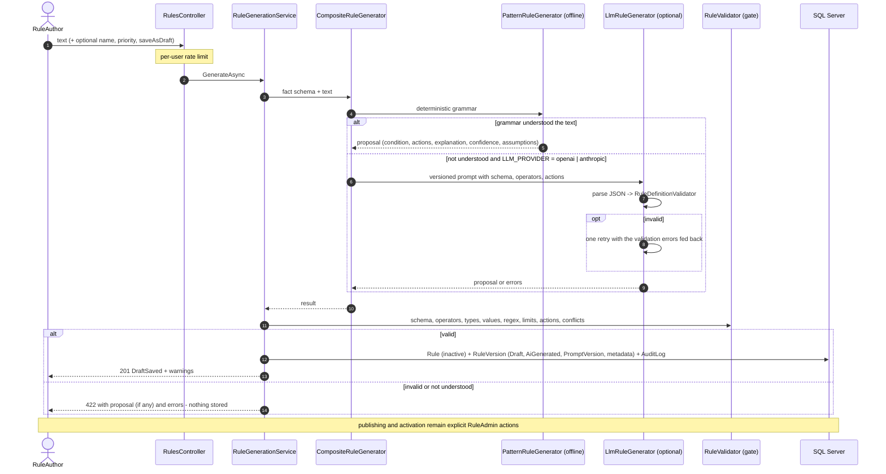

# AI-assisted rule authoring

`POST /api/rulesets/{id}/rules/generate` turns a sentence such as

> Documents with quantity greater than 10 should require manager approval.

into a **proposed Draft rule**. The proposal is never executed, published or activated automatically
([ADR 0002](adr/0002-ai-never-executes-validation-gate.md)).

## Pipeline

## 1. Deterministic grammar (default, offline)

`PatternRuleGenerator` is a small hand-written grammar, **not a language model**. It is the default because it is
free, instant, reproducible and testable, and because most rule sentences follow a few shapes
([ADR 0004](adr/0004-deterministic-first-generation.md)).

Sentence shapes:

| Shape | Example |
|---|---|
| `If/When <condition>[,] then <actions>` | `If amount is at least 50000 and department is IT, require director approval and tag as high-value` |
| `<subject> with/where <condition> should/must <actions>` | `Documents with quantity greater than 10 should require manager approval.` |
| `<actions> where/when/if <condition> [because <reason>]` | `Reject purchase orders where supplier risk rating is one of High, Critical because supplier risk is too high` |

Conditions: clauses joined by `and` / `or` (`and` binds tighter; mixing is flagged as an assumption). A clause is
`<field phrase> <comparator> <value>`; a bare value after `or`/`and` continues the previous comparison
(`department is HR or IT`). Splits are only accepted when both sides parse, so `between 10 and 20` and
`one of IT, HR or Finance` stay intact.

Comparators (longest phrase wins): `is greater than`, `more than`, `above`, `exceeds`, `over`, `>`, `at least`,
`>=`, `less than`, `below`, `under`, `<`, `at most`, `does not exceed`, `<=`, `between X and Y`, `is one of`, `in`,
`is not one of`, `contains`, `does not contain`, `starts with`, `ends with`, `matches`, `is missing`, `is present`,
`is not`, `!=`, `is`, `equals`, `=`, plus `X or more` / `X or less`.

Values are parsed by field type: numbers accept `$50,000`, `50k`, `1.5m` and ignore trailing units (`10 units`,
listed as an assumption); dates use ISO format; booleans accept true/false/yes/no; text comparisons are made
case-insensitive (`ignoreCase: true`).

Actions: `require <role> approval`, `require approval from <role>`, `be approved by <role>`,
`reject [because <reason>]`, `tag as <tag>` / `add tag <tag>`, `notify <channel> [using <template> template]`,
`trigger workflow <name>`, `set <field> to <value>`; several actions can be joined with `and`, `,` or `then`.

### Field mapping (grounding)

`FieldResolver` maps a phrase to a declared field by, in order: normalised path (`document type` ->
`document.documentType` is matched by name), alias (`order value` -> `document.amount`), last path segment
(`quantity` -> `document.quantity`). Ambiguous or unknown phrases are **errors listing the known fields** - a field
is never invented. Mappings that were not exact paths are reported in `assumptions`.

### Confidence and assumptions

Every non-literal interpretation is listed in `assumptions` (default role `Approver`, default rejection reason,
default notification template, ignored units, mixed and/or grouping, subject words that were not turned into
conditions, alias mappings). Confidence starts at 0.95 and drops by 0.1 per substantive assumption (floor 0.4).
It is a transparent heuristic, not a calibrated probability.

## 2. LLM fallback (optional)

Enabled with `LLM_PROVIDER=openai` (+ `OPENAI_API_KEY`, `OPENAI_MODEL`, default `gpt-4o-mini`) or
`LLM_PROVIDER=anthropic` (+ `ANTHROPIC_API_KEY`, `ANTHROPIC_MODEL`, default `claude-sonnet-4-5`). With the default
`offline` no LLM client is registered at all. The LLM is consulted only when the grammar cannot interpret the text.

| Concern | Implementation |
|---|---|
| Transport | Typed `HttpClient`s with hand-written System.Text.Json DTOs (no SDKs): OpenAI Chat Completions with `response_format: json_object`, Anthropic Messages (`anthropic-version: 2023-06-01`) |
| Prompt versioning | `src/RuleEngine.Infrastructure/Ai/Prompts/rule-generation-v1.md`, embedded in the assembly; id `rule-generation/v1` is stored as `PromptVersion` on the generated `RuleVersion` together with generator, model, attempts, confidence and assumptions |
| Grounding | The prompt lists the rule set's fields (types, aliases, descriptions), the operator/type matrix and the action catalogue, and tells the model to answer `{"error": ...}` instead of guessing |
| Structured output | The reply is parsed defensively (outermost `{...}`, so markdown fences are tolerated) and the `condition`/`actions` JSON goes through the same `RuleDefinitionValidator` as manual rules |
| Retry | On validation failure the errors are sent back and the model gets **one** more attempt (`Llm:MaxAttempts`, default 2). A refusal (`{"error": ...}`) is not retried. Provider/HTTP errors fail immediately with a message that never includes the response body |
| Hallucination mitigation | Unknown fields, operators, action types, malformed values, unsafe regexes and limit violations are rejected by the validator; the model cannot add anything the schema does not declare; an LLM proposal always carries the assumption "Generated by a language model; review..." |
| Cost and tokens | Token usage from the provider response (or a ~4 characters/token estimate) is summed across attempts and logged with provider, model, prompt version, attempts and latency. The prompt, the user's text, the model output and API keys are never logged |
| Timeouts | `Llm:TimeoutSeconds` (60 s) on the HTTP client |

## 3. The validation gate

Whatever produced the proposal, `RuleGenerationService` serialises it and runs `RuleValidator`, the exact gate
used by `POST /api/rulesets/{id}/rules`: shape, field existence, operator/type compatibility, value parsing,
`Between` ordering, regex safety, depth/node limits, action parameters, unknown types, plus conflict warnings
against the active rules. Only a valid proposal is stored, as:

* a new rule with `IsActive = false`,
* version 1 with `Status = Draft`, `Source = AiGenerated`, `PromptVersion`, and `GenerationMetadataJson`
  (explanation, confidence, assumptions, generator, model, attempts, source text),
* an `AiDraftGenerated` audit record in the same transaction.

From there the normal lifecycle applies: simulate, add test cases, publish (tests must pass), activate.

## Responses

| Outcome | HTTP | Stored |
|---|---|---|
| `DraftSaved` | 201 + `Location` of the rule | rule + draft version + audit |
| `ProposalOnly` (`saveAsDraft: false`) | 200 | nothing |
| `RejectedByValidation` | 422, proposal and validator errors in `data` | nothing |
| `NotUnderstood` | 422, generator errors | nothing |

## Limitations (deliberate)

* The grammar is English-only and covers common phrasings, not arbitrary prose; the LLM fallback exists for the rest.
* Subjects such as "Invoices ..." are reported as assumptions, not converted into `documentType` conditions,
  because that would be a guess.
* Confidence is heuristic. Review is mandatory by design: generated rules cannot reach production without a
  `RuleAdmin` publishing them.
