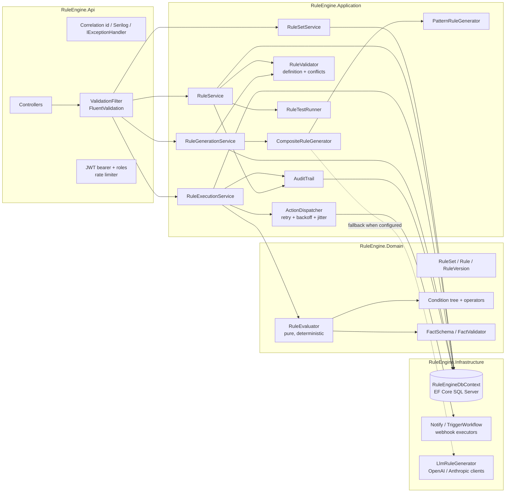
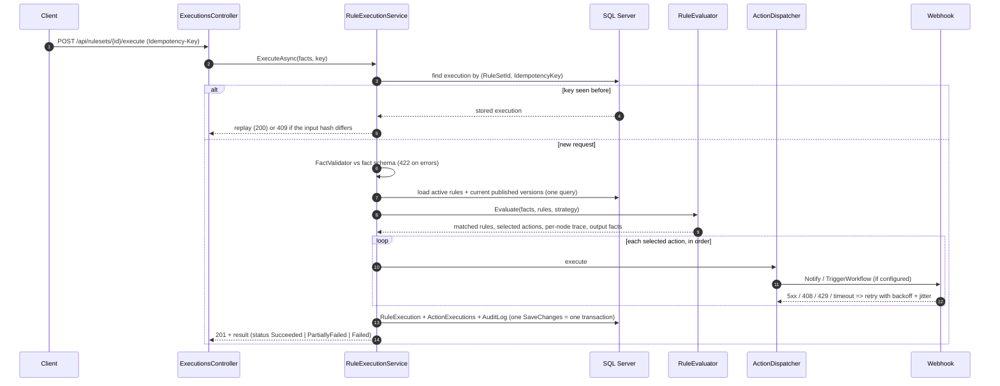
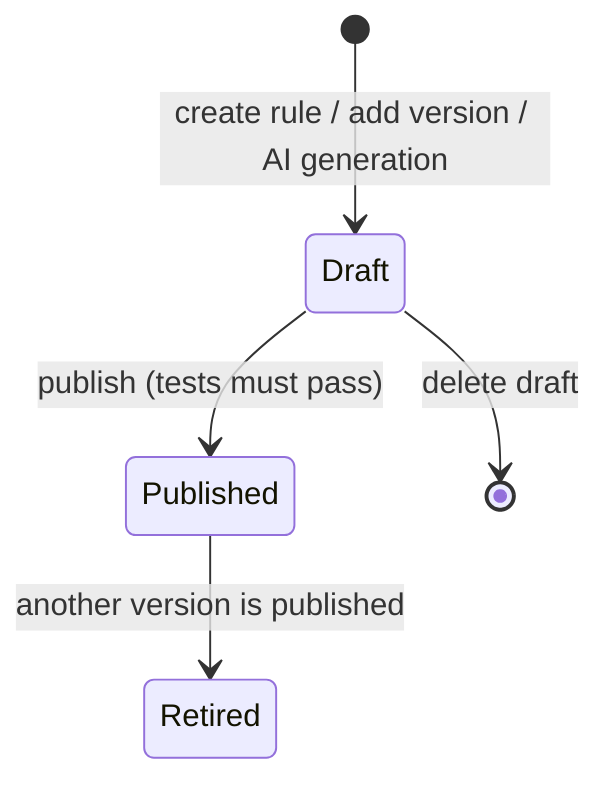

# Architecture

The service is an ASP.NET Core 8 Web API organised with Clean Architecture. Dependencies point inward:
`Api -> Infrastructure -> Application -> Domain`. The Domain project has no package references at all.

## Components

| Layer | Responsibility | Notable types |
|---|---|---|
| Domain | Aggregates and invariants, the condition DSL, the pure evaluator, fact schema validation | `Rule`, `RuleVersion`, `RuleSet`, `RuleEvaluator`, `LeafOperatorEvaluator`, `FactValidator` |
| Application | Use cases, validation gate, conflict detection, execution pipeline, generation, test runner, audit | `RuleService`, `RuleExecutionService`, `ActionDispatcher`, `RuleValidator`, `PatternRuleGenerator` |
| Infrastructure | EF Core persistence and migration, webhook-backed executors, LLM HTTP clients and prompt | `RuleEngineDbContext`, `WebhookClient`, `OpenAiChatClient`, `AnthropicMessagesClient`, `LlmRuleGenerator` |
| Api | HTTP surface, auth, envelope, rate limiting, health, OpenAPI | Controllers, `GlobalExceptionHandler`, `JwtTokenIssuer`, `CorrelationIdMiddleware` |

The application layer talks to EF Core through `IRuleEngineDbContext` (DbSets + `SaveChangesAsync`) rather than
generic repositories; see [ADR 0003](adr/0003-dbcontext-as-unit-of-work.md).

## Execution pipeline

Key points:

* **Evaluation is pure.** `RuleEvaluator` takes facts and already-parsed rule versions and returns a result; it has
  no I/O, clock or randomness, which is what makes simulation, rule tests and traces trustworthy.
* **Actions never stop each other.** Each action gets its own outcome (`Succeeded`, `Failed`, `Skipped`) and attempt
  count. The execution status is derived: all succeeded/skipped -> `Succeeded`, some failed -> `PartiallyFailed`,
  all failed -> `Failed`. The business decision (`NoMatch`, `Accepted`, `ApprovalRequired`, `Rejected`) is derived
  from the selected action types and is independent of delivery failures.
* **Idempotency** is enforced twice: a lookup before work starts, and the unique index
  `(RuleSetId, IdempotencyKey)` that turns a concurrent duplicate into a `DbUpdateException`, after which the
  winner's stored result is returned. The input hash is SHA-256 over canonical JSON (sorted keys), so property
  order does not matter.
* **Side effects happen before the commit.** Webhooks are called before the execution row is written. If the
  database write then fails, a retry with the same Idempotency-Key re-runs the actions. A transactional outbox
  would close that gap; it is listed under future enhancements rather than hidden.

## Simulation and rule tests

`POST /api/rulesets/{id}/simulate` uses the same evaluator but a different loader: for each rule it picks the
latest draft (if newer than the published version) and can include inactive rules. Selected actions are reported
as `NotExecuted`; nothing is persisted or audited.

Rule test cases are stored per rule. `RuleTestRunner` evaluates one rule version in isolation against each case's
facts and compares the match flag and (optionally) the action types. With
`RuleEngine:RequirePassingTestsToPublish=true` (default) publishing re-runs the tests against the version being
published and refuses with 422 if any fail.

## Versioning model

Condition and actions of a `RuleVersion` never change after creation. At most one version is `Published`; the
rule's `IsActive` flag decides whether that version takes part in executions. Every execution stores the ids and
numbers of the versions that matched, so results stay explainable after later edits.

## Cross-cutting concerns

| Concern | Implementation |
|---|---|
| Errors | `GlobalExceptionHandler` (`IExceptionHandler`) maps exceptions to 400/401/404/409/422/500 with the `{ success, message, errors, traceId }` envelope; model-binding errors use the same envelope |
| Validation | FluentValidation validators run by an MVC action filter; domain invariants throw `DomainException` (422) |
| Correlation | `X-Correlation-ID` accepted or generated, returned in responses, pushed to the Serilog log context and stored on executions and audit logs |
| Concurrency | `ConcurrencyStamp` (Guid) is an EF concurrency token on `RuleSet` and `Rule`; clients may also send `expectedConcurrencyStamp` for an explicit 409 |
| Auth | JWT bearer (HS256), roles `RuleAdmin`, `RuleAuthor`, `Executor`, `Auditor`; passwords hashed with `PasswordHasher<User>` |
| Rate limiting | Per-user fixed window on rule generation (`RateLimiting:GenerationPermitsPerMinute`) |
| Health | `/health/live` (process) and `/health/ready` (database) |
| Options | `RuleEngineOptions`, `JwtOptions`, `RateLimitingOptions` validated at startup |
